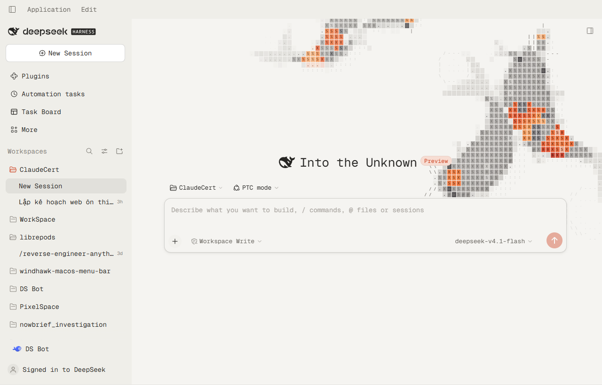
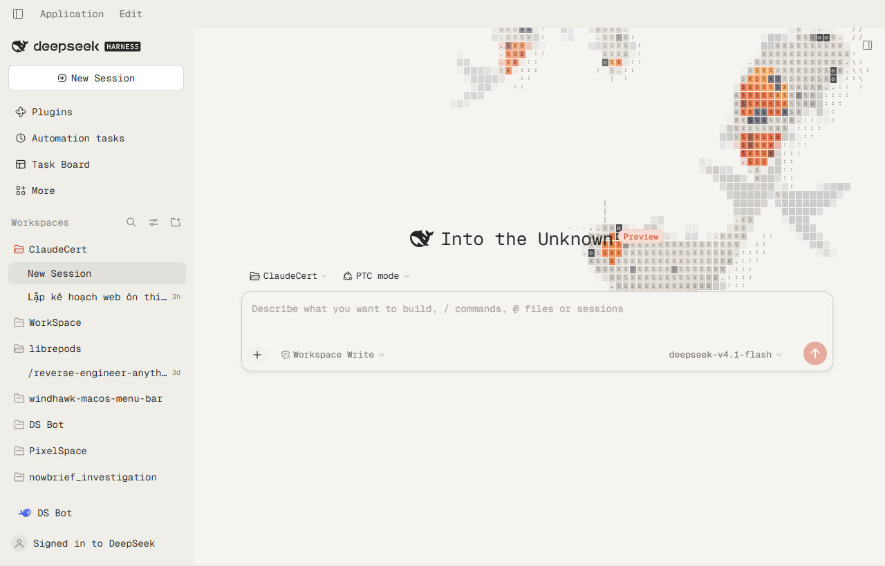

# cngtn Pond — a paper-and-ink theme for DeepSeek Harness

A theme bundle for the DSH Web GUI: warm paper, warm ink, hairline strokes,
near-square corners — and a living ASCII koi pond behind the whole
shell. The visual language is derived from a single-screen portfolio site; the
analysis that produced it lives in
[cngtn-analysis](https://github.com/cngtn/cngtn-analysis).





The reference screenshots the palette was measured against:
[light](docs/reference-light.png) / [dark](docs/reference-dark.png). The
transcript and the Task Board under the theme: [transcript](docs/transcript.png),
[taskboard](docs/taskboard.png).

## What it is

Three layers, registered through the sanctioned third-party-theme extension point
(`ctx.theme.overrideTokens`) plus one stylesheet and one canvas:

| Layer | What it does |
|---|---|
| **Tokens** (230+ pairs) | Paper and ink surfaces, hairline strokes, a tighter radius ladder, true (non-squircle) corners, frosted menus instead of acrylic, and the koi vermilion as the only accent. **No font family**: Settings → Appearance → Font decides, and the stock stacks apply when nothing is chosen. |
| **Stylesheet** | The canvas layer and its paint order, the transparency chain that lets the water show through the shell's frame, the frosted panels and Trajectory cards, and the site's underline-only link treatment. |
| **Canvas** | The pond: koi with a 20-node spine, burst-and-coast tail beats, curiosity toward the pointer, food on click, startle on a fast swipe, depth dives, and an ASCII raster that etches every fish into the same glyph grid as the interface. |

Disabling the plugin removes all three and the GUI returns to its stock design.

## Why it looks the way it does

The design system is four colours, one typeface and almost no decoration:

```
paper  #f5f4f1   ink    #262523      (light)
ink    #1a1917   cream  #fff7f0      (dark)
```

Everything else is derived: `color-mix` of ink over paper for strokes and muted
text, one typeface, 8px on cards and 6px on media, and a
single soft shadow reserved for the one elevated surface.

The one saturated colour is the koi. Its vermilion is step 3 of the pond's own
highlight ramp (`#cc3e1c` on paper, `#e86038` on ink) and it becomes the accent,
the primary button and the business state — but deliberately **not** the error
colour, because "error" and "brand" must never be confusable.

## The pond

The engine is a faithful port of the reference site's `koi-pond/` component,
split the same way:

| File | Ported from | Lines |
|---|---|---|
| `src/world.js` | `world.ts` | 440 |
| `src/shape.js` | `shape.ts` | 79 |
| `src/renderer.js` | `renderer.ts` | 672 |
| `src/engine.js` | `koi-pond.tsx` | 205 |

Nothing was simplified: the seven steering forces, the burst-and-coast tail
beats, the food-selection hysteresis, the startle threshold, the depth model, the
five-point sub-sampled coverage test, the body-anchored glyph hash, the
travelling sheen, the wake diffusion and both palettes are the original's. A
pixel comparison of the darkest body colour against the reference agrees to
within one unit per channel.

Three things did change, because a shell is not a landing page:

1. **Population.** The site seeds 3–6 adults plus two young koi on a full-screen
   canvas. The theme asks for `budget: 0.55`, so a typical 1440×900 window gets
   three fish — enough to read as a pond, few enough to stay out of the way.
2. **Steering targets.** The site tags its own prose with `data-koi-avoid`. A
   theme cannot edit the shell's markup, so it names the shell's published hooks
   instead (`[data-slot="sidebar"]`, `[data-composer-card]`, …). Panels that
   paint their own paper only steer the fish; the ones that do not also fade them
   to a watermark, exactly as the site fades its prose.
3. **Re-seeding on resize.** The site seeds once, because its canvas is always
   correctly sized on the first measurement. In a shell the canvas is inserted
   before its stylesheet lands, so the first rect can be the 300×150 default —
   and the fish would be trapped in that corner forever. The world therefore
   re-seeds whenever the box changes by more than a quarter.

### Seven varieties

The school is stocked the way a real pond is: mostly white-and-red, a few
patterned, and one or two metallic or blue fish for depth.

| Variety | Look |
|---|---|
| kohaku | white, accent head and two or three saddles |
| sanke | kohaku plus small black spots |
| tancho | white, a single accent disc on the crown |
| showa | black back, accent and white patches |
| ogon | one metallic colour, paler along the belly |
| asagi | slate back, accent along the belly |
| bekko | white, black spots only |

Each fish carries its own pigment, and the renderer derives a six-stop ramp from
it — shadowed at the flanks, lit across the back — so a gold koi is shaded by the
same logic as a red one instead of being a recoloured copy.

## Layout

**The sidebar floats.** The frame is a three-column grid, and the sidebar keeps
its 280px track; the cell gains 8px of padding so the card is drawn *inside* it
(264px wide) rather than shrinking the track — the resize handle and the centre
column stay exactly where the shell put them. The card has a 14px radius on all
four corners, a hairline outline, the same frosted fill as the other panels, and
a **progressive shadow**: seven stacked layers whose blur grows geometrically
(1, 2, 4, 8, 16, 28, 44px) at low alpha, plus a 0.5px contact ring. One wide
shadow has a single edge and reads as a band; the stack falls off the way a real
occluder does. Paper and ink get separate alphas, because a black shadow on a
dark page is nearly invisible.

The shadow needed the column to stop clipping: it had `overflow: hidden`, which
cut the shadow to a 12px band at the column edge. The column is now
`overflow: visible` and the rows are clipped by the inner root instead, whose
box is exactly the card's box.

Collapsed, the column is an 18px rail holding one button, so the card styling is
dropped and the rail stays bare.

**The right panel matches it.** Its column is also a grid track, but the panel
is an absolutely positioned occupant that normally meets the window's right
edge. The panel is inset to the same 10/12/20/18px box as the sidebar, with the
same 14px radius, hairline and progressive shadow, while the track and resize
handle stay where the shell put them. Expanded, it is the same card stretched
over the conversation, frosted over the chat instead of clear: the sheet is a
58% paper tint under `blur(26px)`, and the column is raised above the centre
column so nothing paints over the card. Closed, the card, the sheet and the
raised stacking all go away with it.

**The titlebar is transparent.** No fill, no blur: the pond runs to the top edge
of the window and the caption floats over the water. The native minimise /
maximise / close buttons stay an opaque block in the top-right corner — Windows
composites their overlay without alpha, so no theme can make them transparent.
That block is the one place where the chrome and the water disagree.

## Install

```powershell
dsh plugin --profile desktop add github:cngtn/dsh-cngtn-pond
```

That is the same command shape as any other DSH plugin: `dsh plugin` forwards to
pnpm inside the profile, so the package is installed, its `dsh.bundle` patch is
read, and the bundle is appended to `dsh.profile.bundles` automatically.

Once the package is on npm, the versioned form works too:

```powershell
dsh plugin --profile desktop add @cngtn/dsh-cngtn-pond@latest
```

To pin an exact revision of the repository:

```powershell
dsh plugin --profile desktop add github:cngtn/dsh-cngtn-pond#<commit>
```

Remove it the same way:

```powershell
dsh plugin --profile desktop remove @cngtn/dsh-cngtn-pond
```

Then restart DeepSeek Harness. Only one theme at a time: token layers stack and
the last one registered wins per token, so disable any other theme bundle first.

### Settings on the plugin page

The pond's three settings are declared in the **Host** half (`index.js`, a
schemastery `Config`), which is what lets the Plugins page describe them, and the
**Client** half registers a form for the `plugins.bundle.config` slot under the
bundle's package name. Open **Plugins → cngtn Pond** and the form sits between the
description and the component rows:

| Field | Range | Meaning |
|---|---|---|
| Fish | 3–12 | Total school size, young koi included |
| Colour | `mixed` / `warm` / `cool` / `mono` | Which pigments the fish draw from |
| Young koi | on / off | The two small fish that keep to the deep water |

Save writes through the Host config document; the running pond follows the same
scope, so the change lands immediately without a restart. The same values can be
set from the floating **Pond** panel or the console:

```js
cngtnPond.open()
cngtnPond.set({ fish: 9, palette: 'warm' })
cngtnPond.get()
cngtnPond.list()
cngtnPond.diag()   // what the settings wiring reached
```

A profile can also ship a house style by setting the row's `config` in
`cordis.patch.yml`; the Host config, once saved, takes precedence over it.

### Manual install

```powershell
cd $env:USERPROFILE\.dsh\profiles\desktop
dsh plugin --profile desktop add "file:C:/path/to/dsh-cngtn-pond"
```

## Build and test

The shell evaluates `client.js` through `window.__ModuleLoader__` and cannot
compile anything, so the client half ships as one generated file. Edit `src/`,
then:

```powershell
npm run build   # inlines src/ + the vendored fonts into client.js
npm test        # boot contract + a ten-minute headless simulation
npm run verify http://127.0.0.1:9333   # read the live page over CDP
```

`npm test` runs both checks in `test/`. `npm run verify` connects to a running
DSH (the desktop app needs `--remote-debugging-port=9333`; a `web` profile is
already an HTTP page) and prints the state table below, so any claim about the
theme can be re-checked rather than taken from a screenshot.

`npm test` runs two checks that a syntax pass cannot:

- **boot.mjs** — the factory registers, the module exports `apply` + `inject`,
  every token is a `{ light, dark }` string pair (the rule the theme runtime
  enforces by throwing), and each effect returns a disposer.
- **smoke.mjs** — 36 000 fixed steps with a moving pointer, repeated feeds and
  swipes, asserting that no spine node ever goes NaN, that a fed koi takes a
  pellet, that the pellet and ripple counts stay capped, and that a large resize
  re-seeds while a small one does not.

## The Trajectory tab

Trajectory is a different surface from the transcript: a `<table>` of every
step, inside an overlay that paints the page colour. Left alone it is the one
view where the pond disappears and the list reads as one long striped block.

The theme turns the tab into a ledger of glass cards:

| Layer | What it becomes |
|---|---|
| `[data-conversation-composer-overlay]` | transparent — this hook exists only in Trajectory, so the rule cannot touch Chat |
| the sticky filter bar | a `58 %` tint over `blur(16px)`, so Duration / Turns / Calls / Search stay readable while the ledger scrolls under it |
| `[data-trajectory-scroll]` | an `18 %` sheet over `blur(14px)` |
| each `tr[data-trajectory-row-key]` | a card: `30 %` tint, `blur(14px)`, 10px corners, hairline outline, 6px gap to the next card |

A `<tr>` cannot carry a radius, so the card is drawn through its two cells —
first cell takes the left corners, last cell the right ones, both share one tint
and one filter. `border-spacing: 0 6px` supplies the gap. The table keeps
`table-layout: fixed` and the virtualiser keeps measuring rows; a row is simply
36px tall instead of 30px now, which it observes like any other size change.

## What is deliberately not copied

| From the site | Why not |
|---|---|
| One screen, `overflow: hidden` | The shell is a multi-panel application; locking scroll would break it |
| `px-[20vw]` gutters | The shell has a sidebar; gutters must follow the container, not the viewport |
| `pond / projects / gallery / blog` nav | The shell owns its navigation |
| Citation hover cards | There is no source data in the shell to cite |
| `defaultTheme="dark"` hard-coded | The user's Light/Dark preference is theirs to set |
| Playfair 14vw mobile menu | The shell has no full-screen mobile menu |

The rule: **copy the visual language, not the information architecture.**

## Licence

The theme sets no font family, so nothing is redistributed: typography comes
from DSH's own stacks and the user's Settings choice. The `fonts/` directory is
kept only as the source of the original reference; it is no longer inlined into
`client.js`. Everything else in this bundle is original work.
## Verified on this machine

Recorded on the DSH desktop app (0.2.1-rc.3, Windows 11) and the `web` profile,
after `dsh plugin --profile … install` and a restart.

| Check | Result |
|---|---|
| Bundle activates | `@cngtn/dsh-cngtn-pond` reaches `active`; no boot-audit entry |
| Canvas mounted | `#cngtn-pond-canvas` present, 1280×820 in the app, 1440×900 in the browser |
| Pond painting | 23k–66k non-transparent pixels, moving between frames |
| Tokens (light) | `--dsw-alias-bg-base` `#f5f4f1`, `--dsw-alias-label-primary` `#262523`, brand `#cc3e1c` |
| Tokens (dark) | `--dsw-alias-bg-base` `#1a1917`, `--dsw-alias-label-primary` `#fff7f0`, brand `#e86038` |
| Shape | `--dsw-radius-md` `8px`, `--dsw-corner-shape` `round` |
| Material | menus and panels frosted: `--dsw-menu-backdrop-filter` `blur(26px) saturate(160%)`, fills `color-mix(… 55%, transparent)` |
| Fonts | the theme sets none: `--dsh-font-family-text-default` keeps the shell's stack (Segoe UI on this machine) and a font chosen in Settings wins |
| Frame transparency | frame and centre column compute to `rgba(0, 0, 0, 0)`; every panel is a frosted sheet |
| Titlebar | the 40 px Windows caption strip computes to a 58 % tint over `blur(22px)`, so `Application / Edit` floats on the same glass as the panels |
| Chat glass | only two blocks are frosted: the sent bubble (`46 %` tint + `blur(14px)`) and the code / command card (`30 %` + `blur(14px)`). The transcript column itself computes to `backdrop-filter: none`, so response prose stays crisp |
| Trajectory glass | the tab's overlay is transparent, the ledger scrolls on an `18 %` sheet, and every row is a card: `30 %` tint, `blur(14px)`, 10px corners on all four sides, 6px gap between rows |
| Koi steering | the koi swim under the glass panels rather than around them |
| Text legibility | response prose sits on the open water; the two frosted blocks carry their own tint |
| Frame budget | 180 frames: p50 16.7 ms, p95 16.8 ms, max 16.9 ms (60 Hz, no dropped frame) |
| Other plugins | Task Board renders and scrolls normally under the theme |
| Fidelity | darkest koi body pixel `rgb(114,28,14)` vs the live site's `rgb(113,26,14)` |

Two things this machine cannot check, and which the user should confirm:

- **Subjective feel.** The pond's population is a judgement call (three adults
  plus two young koi at 1280–1440 px wide); `budget` in `src/apply.js` is the one
  number to change.
- **A real `prefers-reduced-transparency` toggle.** The code path is implemented
  and the engine clears its canvas on it, but Windows exposes the flag through
  Settings → Accessibility → Visual effects, which was not toggled here.
